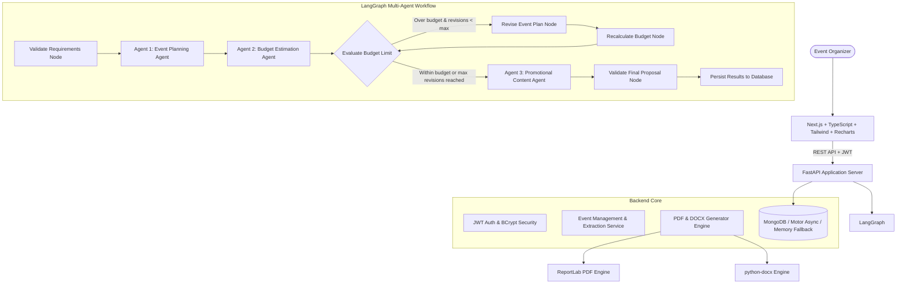

# EventMind AI — Intelligent Event Management System

> **Plan Smarter. Spend Better. Promote Faster.**  
> An enterprise-grade, multi-agent AI event management system orchestrating three specialized autonomous agents via **LangGraph** to deliver comprehensive event schedules, deterministic budgets, task registers, and promotional campaigns.

---

## 1. Project Overview

**EventMind AI** transforms natural-language event requirements into structured, synchronized, and actionable event portfolios. Designed for organizers handling college festivals, technical hackathons, corporate conferences, product launches, workshops, and private celebrations, the platform bridges creative event design with deterministic financial discipline.

### Why Multi-Agent AI?
Traditional single-prompt LLM event tools often hallucinate arithmetic, skip logistical constraints, or generate inconsistent details across marketing channels. EventMind AI implements a typed state machine where:
1. **Agent 1 (Event Planning Agent)** structures timelines, equipment, and risk contingencies.
2. **Agent 2 (Budget Estimation Agent)** computes itemized expenses using deterministic Python `Decimal` arithmetic—guaranteeing zero floating-point drift or hallucinated math.
3. **Budget Optimization Loop (LangGraph Conditional Routing)** detects budget overruns and executes bounded revisions to align scope with financial limits.
4. **Agent 3 (Promotional Content Agent)** creates platform-tailored marketing copy based strictly on verified event facts.

---

## 2. System Architecture



---

## 3. Multi-Agent Workflow

```mermaid
sequenceDiagram
    autonumber
    actor Organizer
    participant API as FastAPI Backend
    participant Graph as LangGraph Orchestrator
    participant A1 as Planning Agent
    participant A2 as Budget Agent
    participant A3 as Promotional Agent
    participant DB as MongoDB / Storage

    Organizer->>API: Submit Event Prompt / Form
    API->>Graph: Trigger Workflow (Typed State)
    Graph->>A1: plan_event()
    A1-->>Graph: Master Schedule, Tasks, Risks, Equipment
    Graph->>A2: estimate_budget()
    A2-->>Graph: Deterministic Line Items & Subtotal
    
    rect rgb(30, 41, 59)
        Note over Graph,A2: Conditional Budget Evaluation Edge
        alt Total Cost > Available Budget Limit
            Graph->>A1: revise_event_plan(feedback)
            A1-->>Graph: Revised Scope
            Graph->>A2: recalculate_budget()
            A2-->>Graph: Updated Financials
        end
    end

    Graph->>A3: generate_promotional_content()
    A3-->>Graph: Instagram, LinkedIn, WhatsApp, Email, Poster, Calendar
    Graph->>DB: save_results() (Version 1 Artifacts)
    Graph-->>API: Completion Status (100%)
    API-->>Organizer: Live Generation Preview & Proposal Downloads
```



---

## 4. Key Features

- **Multi-Agent Orchestration**: Powered by LangGraph StateGraph with shared typed state, error recovery, and bounded revision loops (max 2 attempts).
- **100% Deterministic Financial Arithmetic**:
  - Safe Python `Decimal` computations: `line_total = quantity * unit_cost`, `subtotal = sum(line_total)`, `contingency = subtotal * contingency_rate`.
  - Division-by-zero protection.
  - Zero hallucinated LLM math.
  - Automated Economy, Standard, and Premium scenario generation.
  - Actionable cost-cutting alternatives with trade-off explanations.
- **Natural Language Requirements Extractor**: Form autofill powered by intelligent entity extraction parsing attendees, budgets, cities, dates, and activities.
- **Interactive Budget Analytics**: Dynamic category pie charts and scenario comparison bar charts powered by **Recharts**.
- **Actionable Task Register**: Interactive milestone tracking with priority badges, role assignments, and live status toggle.
- **Omni-Channel Marketing Studio**: In-place editable copy, copy-to-clipboard, tone selector (Formal, Professional, Energetic, Casual), and poster canvas preview.
- **Document Generation**: Instant one-click export of consolidated proposals to styled **PDF** (ReportLab) and **Word DOCX** (python-docx).
- **High-Fidelity Demo Mode**: Deterministic domain intelligence engine that works out-of-the-box without paid API keys.
- **Fault-Tolerant Storage**: Motor async MongoDB driver with automatic fallback to memory/disk store if local mongod is offline.

---

## 5. Technology Stack

### Frontend
- **Framework**: Next.js 16+ (App Router), React 18, TypeScript
- **Styling**: Tailwind CSS with custom dark mode design system
- **Charts**: Recharts
- **Icons**: Lucide React
- **Forms & Validation**: React Hook Form, Zod

### Backend
- **Framework**: Python 3.12, FastAPI, Uvicorn
- **Orchestration**: LangGraph StateGraph, LangChain Core
- **AI / LLM Integration**: Official OpenAI SDK with Demo Mode fallback
- **Validation**: Pydantic v2 & Pydantic Settings
- **Database**: MongoDB with Motor (AsyncIO) & PyMongo
- **Document Export**: ReportLab (PDF), python-docx (DOCX)
- **Security**: PyJWT, BCrypt password hashing
- **Testing**: Pytest, Pytest-Asyncio, HTTPX

---

## 6. Project Directory Structure

```text
eventmind-ai/
├── frontend/
│   ├── app/
│   │   ├── layout.tsx                     # Root dark-mode layout with Suspense boundaries
│   │   ├── globals.css                    # Tailwind CSS v4 styling & theme tokens
│   │   ├── page.tsx                       # Page 1: Landing Page
│   │   ├── dashboard/
│   │   │   └── page.tsx                   # Page 2: Dashboard with portfolio KPIs & search
│   │   └── events/
│   │       ├── create/
│   │       │   └── page.tsx               # Page 3: Create Event with AI Autofill
│   │       └── [id]/
│   │           ├── page.tsx               # Page 8: Event Details & Export Hub
│   │           ├── workspace/
│   │           │   └── page.tsx           # Page 4: AI Generation Workspace & Live Agents
│   │           ├── plan/
│   │           │   └── page.tsx           # Page 5: Master Schedule Timeline & Tasks
│   │           ├── budget/
│   │           │   └── page.tsx           # Page 6: Budget Dashboard with Recharts
│   │           └── marketing/
│   │               └── page.tsx           # Page 7: Marketing Studio across platforms
│   ├── components/
│   │   ├── Navbar.tsx                     # Navigation header
│   │   └── Footer.tsx                     # SaaS footer
│   ├── lib/
│   │   └── api.ts                         # Centralized TypeScript API client
│   ├── package.json
│   ├── Dockerfile
│   └── tsconfig.json
├── backend/
│   ├── app/
│   │   ├── main.py                        # FastAPI application entrypoint & lifespan
│   │   ├── core/
│   │   │   ├── config.py                  # Pydantic Settings
│   │   │   └── security.py                # JWT & BCrypt password hashing
│   │   ├── database/
│   │   │   └── connection.py              # MongoDB Motor client + In-Memory fallback
│   │   ├── schemas/
│   │   │   ├── event.py                   # Event Pydantic models
│   │   │   ├── plan.py                    # Event Planning Agent schemas
│   │   │   ├── budget.py                  # Budget Estimation Agent schemas
│   │   │   ├── promotion.py               # Promotional Content schemas
│   │   │   ├── workflow.py                # Generation Job schemas
│   │   │   └── auth.py                    # User authentication schemas
│   │   ├── agents/
│   │   │   ├── llm_provider.py            # Unified LLM provider & Demo Mode engine
│   │   │   ├── planner.py                 # Agent 1: Event Planning Agent
│   │   │   ├── budget_agent.py            # Agent 2: Budget Estimation Agent
│   │   │   └── promotion_agent.py         # Agent 3: Promotional Content Agent
│   │   ├── workflows/
│   │   │   ├── state.py                   # Typed Workflow State
│   │   │   └── graph.py                   # LangGraph StateGraph & bounded revision loop
│   │   ├── services/
│   │   │   ├── budget_service.py          # Deterministic Decimal calculation engine
│   │   │   └── proposal_service.py        # ReportLab PDF & python-docx export engine
│   │   ├── api/
│   │   │   └── routes/
│   │   │       ├── health.py              # GET /api/health
│   │   │       ├── auth.py                # POST /api/auth/register, /login, /me
│   │   │       ├── events.py              # CRUD & /extract-prompt
│   │   │       ├── workflow.py            # /generate, /generation-status, /recalculate
│   │   │       ├── tasks.py               # Task register & status updates
│   │   │       ├── promotion.py           # Promotion copy retrieval & editing
│   │   │       └── proposals.py           # PDF/DOCX proposal streaming
│   │   └── tests/                         # Pytest test suite (17 passed)
│   ├── requirements.txt
│   ├── pytest.ini
│   ├── .env.example
│   └── Dockerfile
├── docker-compose.yml
├── .env.example
├── .gitignore
└── README.md
```

---

## 7. Prerequisites

- **Python**: 3.12+
- **Node.js**: 20+
- **npm**: 10+
- **Docker & Docker Compose** (Optional for containerized run)

---

## 8. Installation & Local Development Setup

### Step 1: Clone Repository & Configure Environment
```bash
git clone <repo-url>
cd eventmind-ai
cp .env.example .env
```

### Step 2: Backend Setup
```bash
cd backend
python -m venv .venv

# On Windows:
.\.venv\Scripts\activate
# On Linux/macOS:
source .venv/bin/activate

pip install -r requirements.txt
```

### Step 3: Frontend Setup
```bash
cd ../frontend
npm install
```

---

## 9. Running the Application Locally

### Launch Backend Server
```bash
cd backend
# Windows:
.\.venv\Scripts\python.exe -m uvicorn app.main:app --host 127.0.0.1 --port 8000 --reload
# Linux/macOS:
uvicorn app.main:app --host 127.0.0.1 --port 8000 --reload
```
- API Base: `http://localhost:8000`
- Swagger UI Documentation: `http://localhost:8000/api/docs`

### Launch Frontend Application
```bash
cd frontend
npm run dev
```
- Web Application: `http://localhost:3000`

---

## 10. Docker Deployment

Deploy the entire stack (MongoDB + FastAPI + Next.js) with a single command:
```bash
docker compose up --build
```
- Frontend: `http://localhost:3000`
- Backend API: `http://localhost:8000/api/docs`
- MongoDB: `localhost:27017`

---

## 11. Environment Configuration Reference

| Variable | Description | Default |
| :--- | :--- | :--- |
| `MONGODB_URI` | MongoDB connection string | `mongodb://localhost:27017` |
| `MONGODB_DATABASE` | Database name | `eventmind_ai` |
| `OPENAI_API_KEY` | OpenAI API Key (Optional) | `""` (Activates Demo Mode) |
| `OPENAI_MODEL` | Target language model | `gpt-4o-mini` |
| `AI_DEMO_MODE` | Force deterministic demo synthesis | `true` |
| `JWT_SECRET_KEY` | Random secret key for JWT signing | `replace_in_production` |
| `ACCESS_TOKEN_EXPIRE_MINUTES` | Token expiration duration | `1440` (24 Hours) |
| `MAX_REVISION_COUNT` | LangGraph budget revision attempts | `2` |
| `NEXT_PUBLIC_API_URL` | Frontend API target | `http://localhost:8000/api` |

---

## 12. REST API Documentation

| Method | Endpoint | Description |
| :--- | :--- | :--- |
| `GET` | `/api/health` | Service health, DB connectivity & AI provider mode |
| `POST` | `/api/events` | Create new event draft |
| `GET` | `/api/events` | List all organized events (auto-seeds TechFest 2026 demo) |
| `GET` | `/api/events/{id}` | Retrieve event details by ID |
| `PATCH` | `/api/events/{id}` | Update event parameters |
| `DELETE` | `/api/events/{id}` | Delete event and related plan, budget, & promotions |
| `POST` | `/api/events/extract-prompt` | AI natural-language prompt requirements extractor |
| `POST` | `/api/events/{id}/generate` | Trigger LangGraph multi-agent orchestration |
| `GET` | `/api/events/{id}/generation-status` | Real-time agent status tracker & output previews |
| `POST` | `/api/events/{id}/regenerate-plan` | Regenerate timeline and schedule |
| `POST` | `/api/events/{id}/recalculate-budget` | Recalculate line items, subtotal, and contingency |
| `POST` | `/api/events/{id}/regenerate-promotion` | Regenerate platform copy by tone and audience |
| `GET` | `/api/events/{id}/tasks` | Retrieve task register |
| `PATCH` | `/api/events/{id}/tasks/{task_id}` | Update task status, priority, or deadline |
| `GET` | `/api/events/{id}/promotion` | Get multi-platform marketing copy |
| `PATCH` | `/api/events/{id}/promotion` | Save custom edits to marketing copy |
| `GET` | `/api/events/{id}/proposal/download` | Download PDF or Word (.docx) proposal |

---

## 13. Automated Test Suite

The test suite covers deterministic arithmetic, Pydantic schemas, agent outputs, LangGraph workflow execution, and REST endpoints.

Run tests using pytest:
```bash
cd backend
.\.venv\Scripts\pytest.exe -v
```

### Test Results:
```text
============================= test session starts =============================
platform win32 -- Python 3.12.10, pytest-9.2.0, pluggy-1.7.0
configfile: pytest.ini
collected 17 items

app/tests/test_agents.py::test_planning_agent_generates_valid_structure PASSED [  5%]
app/tests/test_agents.py::test_budget_agent_uses_deterministic_calculations PASSED [ 11%]
app/tests/test_agents.py::test_promotional_agent_consistency_and_placeholders PASSED [ 17%]
app/tests/test_api.py::test_health_endpoint PASSED                       [ 23%]
app/tests/test_api.py::test_events_crud_and_validation PASSED            [ 29%]
app/tests/test_api.py::test_natural_language_extraction PASSED           [ 35%]
app/tests/test_budget_arithmetic.py::test_calculate_line_item_valid PASSED [ 41%]
app/tests/test_budget_arithmetic.py::test_calculate_line_item_rejects_invalid PASSED [ 47%]
app/tests/test_budget_arithmetic.py::test_budget_deterministic_calculation_within_limit PASSED [ 52%]
app/tests/test_budget_arithmetic.py::test_budget_overrun_detection PASSED [ 58%]
app/tests/test_budget_arithmetic.py::test_division_by_zero_protection PASSED [ 64%]
app/tests/test_budget_arithmetic.py::test_scenario_generation PASSED     [ 70%]
app/tests/test_schemas.py::test_event_create_validation_success PASSED   [ 76%]
app/tests/test_schemas.py::test_event_create_validation_rejects_negative_budget PASSED [ 82%]
app/tests/test_schemas.py::test_line_item_validation_rejects_zero_quantity PASSED [ 88%]
app/tests/test_workflow.py::test_workflow_execution_end_to_end PASSED    [ 94%]
app/tests/test_workflow.py::test_evaluate_budget_condition_bounded_revisions PASSED [100%]

============================= 17 passed in 2.43s ==============================
```

---

## 14. Demo Event: TechFest 2026

The platform comes pre-seeded with the canonical demo event:
- **Event Name**: TechFest 2026
- **Type**: Technical College Festival
- **Location**: Pune, Maharashtra
- **Attendees**: 500 Students & Delegates
- **Authorized Budget**: ₹2,00,000 (INR)
- **Features**: Master schedule, itemized budget across 13 categories, 10% safety contingency buffer, 3 tier scenarios, task register, Instagram reels script, LinkedIn announcement, WhatsApp broadcast, and downloadable PDF & DOCX proposals.

---

## 15. Security & Reliability

- **Zero Floating-Point Drift**: All financials handled via safe Decimal calculations.
- **Fail-Safe Database**: Automatic fallback to in-memory store prevents application crashes when MongoDB is not running locally.
- **No Secrets in Source**: All API keys, database credentials, and JWT secrets are managed strictly through environment variables.
- **Input Sanitization**: Strict Pydantic schema validation rejects negative costs, zero quantities, and malformed inputs.
- **Bounded Revision Loops**: LangGraph enforces a hard limit of 2 optimization attempts to eliminate potential infinite loops.

---

## 16. License

This project is released under the **MIT License**.
